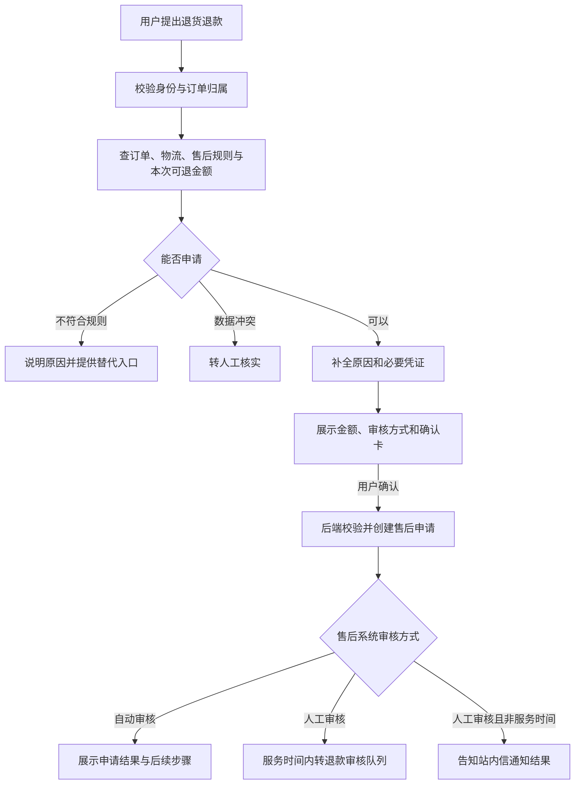

# ShopBot 电商智能客服 Agent — PRD（人看版）

| 项目 | 内容 |
| --- | --- |
| 文档版本 | v1.11 · 公开修订版 |
| 更新日期 | 2026-10-31 |
| 产品负责人 | 余时豪 |
| 历史基线 | GitHub `main` 的 `90d40bfd`（2026-10-30 业务规则）；本版补健康必转、指标和证据口径，历史评测保留 |
| 完整规范 | [PRD（AI 版）](ShopBot电商智能客服%20PRD.md)，本文由其派生，规则和数值以 AI 版为准 |
| 配套材料 | [在线原型](https://yshihao636.github.io/shopbot-demo/) · [作品集](https://yshihao636.github.io/shopbot-demo/ShopBot%E4%BD%9C%E5%93%81%E9%9B%86.html) · [离线评测报告](ShopBot离线评测报告.md) |

本文是当前需求定义的阅读版。产品分 v0.1–v0.5 交付，生产接口、参数与灰度效果仍有待验证项；文档修订不代表已经上线。

## 1. 做什么，给谁，为什么做

ShopBot 是电商用户的客服入口：用户通过对话查询订单、物流和售后，提交申请，在规则与授权范围内办理业务；需要人工时带着上下文交接。

一期聚焦「订单—物流—售后」主链路，服务两类核心用户：想查进度、退货退款的买家，以及接手会话、审核售后的坐席。优先解决重复查询耗时、跨系统状态不一致、申请流程分散和接手后反复询问的问题。

本平台尚无历史客服基线。公开 CSDS 对话的 1,000 会话代理分析显示：46.7% 含订单号，32.9% 涉及办理类意图，前 10 类意图占 65.8%。分类由冻结模型完成、未经人工抽检，只用于判断需求结构。重复问题占用 60% 以上客服时间、排队超过 30 分钟属于经验假设，不能作为本平台实测成果。

选择 Agent，是为了处理非标准表达、多轮补全和跨系统查询；身份、规则、金额、业务写入与授权仍由工具和后端校验。依据：AI 版 P1.1–P1.3、模块 1、2、5。

## 2. 目标与衡量方式

北极星指标是**自动解决率**：至少有一条用户消息，诉求达到「闭环完成」，有成功工具结果或已发布知识引用且已展示给用户，未转人工、未留言。分母为总会话数，含空会话；空会话另列，转人工率与它不互补。

会话从登录 / 验证后服务端成功创建 `conversation_id` 起计，明确结束或默认 15 分钟无交互时结束；收起窗口、重连不重复计数，按开始日归属，日终值 T+1 结算。v0.1 的自解决分子只计工具成功结果，售后规则从 T08 获取；知识问答自解决随 v0.2 商品咨询 / A09 开放。详见 AI 版 7.2。

| 指标 | 一期目标（v0.1–v0.2） | 当前证据 |
| --- | --- | --- |
| 自动解决率 | ≥40% | 需真实流量；离线端到端成功率不能替代 |
| 转人工率 | ≤50% | 需真实流量 |
| CSAT | ≥3.8/5.0 | 需真实用户评价；并列样本数、评价回收率与触发率 |
| 高风险误操作率 | =0 | agent-v1 红队 132 次运行严重违规 0，仅覆盖本评测集 |
| 退款纠纷率 | ≤8% | 需线上售后数据 |
| 平均首次响应时间 | ≤3s | 尚未直接测量；分类调用耗时不等于首次响应时间 |
| 人工客服节省率 | ≥30% | 需录入上线前基线月工时 |
| P0 意图准确率 | ≥90% | 全 15 意图均值 92.67%，首跑区间下限 90.1%；v0.1 的 6 意图事后切片均值 86.67%，未达 90% |

目标唯一来源为 AI 版 1.4，指标定义见 7.1–7.2，P0 意图门槛见 9.1。原型中的运营数字为虚构展示值；P0 意图 92.7% 来自离线评测。

40%、3.8、8% 是尚无本平台基线推导的设计目标，须由灰度流量校准。评价回收率 = 提交评价会话 / 实际展示评价会话，跳过计入分母；另报展示评价 / 非空已结束会话的触发率，避免只看高均分。

**成本与首响预算：** 模型观测 ¥0.0066 / 次模拟任务不等于每次解决成本。全成本须纳入基础设施、工具、人工接管、质检返工与运维，除以最终解决任务数，再与同类纯人工成本比较。AI 版 7.2.1 提供公式与全是假设的 ¥3.15 vs ¥5.00 算例；首响规划分配 0.2s 入口/路由 + 1.6s 分类 + 0.5s 查询 + 0.5s 生成 + 0.2s 发送，合计 3.0s。完整成本与首响均未实测，不能作为收益或性能成果。

## 3. 方案与核心流程

产品由客户端 12 个场景和管理端 14 个页面组成。客户端负责查询、申请、确认、进度与转人工；管理端承接坐席、质检、审计、护栏、告警和灰度发布。页面起始版本按 AI 版 P2.1，完整交互按 P2.4–P2.5。

以退货退款为例：

v0.1 的 Agent 只创建申请，审核与退款由现有售后系统完成。Agent 执行退款规划在 v0.4；阈值内仍需用户确认、风控与人工审核。申请成功、审核通过、退款到账是不同状态，话术必须对应真实结果。

## 4. 关键设计与理由

| 决策 | 最终规则 | 理由与依据 |
| --- | --- | --- |
| 金额从哪里来 | 采用系统返回的本次可退金额，已扣已退款并按优惠分摊；缺少金额不出确认卡 | 防止用户口述或模型计算导致超退；C03、5.7、9.1 |
| 退款与取消分别设阈值 | 单笔自动退款默认 ¥500；已支付未发货取消默认 ¥5,000。取消金额低于阈值二次确认，达到阈值需人工审核 | 两类操作风险不同；D1、4.5、5.6。生产值待企业确认 |
| 什么时候必须上传凭证 | 质量问题、与描述不符、收到破损须上传；退货退款金额超过自动审核阈值时，无理由退货也须上传；售后规则要求时同样必填 | 人工审核要有依据；D5、C03。图片或视频作为凭证，视频交售后审核 |
| 人工审核怎样解释 | 金额超阈值可直接说明；退款次数、30 天退款金额、风控、开关或投诉历史等原因统一说明需进一步核实 | 减少无效追问并保护风控规则；C03、5.8 |
| 拣货中怎样取消 | 有受控拦截能力才尝试；拦截成功才告知已取消。无法拦截或结果不确定时建取消申请，不保证成功 | 防止出现已承诺取消却继续发货；D3、C02 |
| 人工怎样接手 | 主动要求人工、强情绪、连续识别失败、风控或数据冲突等触发转接；交接附诉求、身份验证状态、订单、处理结果和待办摘要 | 减少重复询问，保留明确出口；C06、模块 6 |
| 过敏等健康风险 | 商品相关过敏、不良反应、疑似健康伤害或相关医疗建议请求须高优先级转人工；路由先于模型执行，后端阻止新旧确认与提交，失败时保留出口 | 不依赖模型主动检索售后规则；AI 版 5.3、6.2、PUB-AC-09 |

通用约束：先做只读验证再写入；用户发起的 R2 及以上动作先确认，系统发起的物流调查工单等按原规则执行。P0 信息最多追问 2 轮仍缺失时停留补全或转人工。工具失败不编造事实，不把未知结果说成成功。依据：P2.3、3.3、4.6、模块 8。

## 5. 范围与分期

| 产品版本 | 最终范围 |
| --- | --- |
| v0.1 MVP | App 内对话与兜底；订单、物流、会员等级与积分只读查询；退货退款申请与进度；转人工与坐席工作台；安全护栏、运维开关、审计、核心告警；服务评价、人工抽检和灰度管理最小集 |
| v0.2 | 投诉申诉工单、取消未支付订单、商品咨询、知识库、LLM-Judge 与扩展质检、催发货与签收争议工单等 |
| v0.3 | 换货补发维修、优惠券与价保申请、发票、账户隐私请求、积分异常；已支付未发货订单取消、修改地址；标签、反馈、配置及成本熔断 |
| v0.4 | Agent 执行退款、价保退差价、补偿券等受控资金动作，以及提醒、坐席绩效、AB 实验 |
| v0.5 | 复杂售后、大额退款人机协同、平台仲裁、多系统冲突、法律监管专项及 App 以外渠道 |

**能力还受灰度阶段控制**：Phase 0（内部 30 人）和 Phase 1（5%）只开放 L0–L1；Phase 2（20%）开放至 L2；Phase 3（50%）至 L3；Phase 4（100%）至 L4。所属版本已发布、阶段已开放，两项同时满足才可用。取消已支付订单、修改地址在 Phase 4 且对应版本发布后才进入受控执行。

全版本不做商家入驻与店铺运营、广告投放、法律结论性答复、竞品评价。账户注销和个人数据删除只建专岗请求，不自动执行。L5 始终由人工处理。依据：P1.4、1.3、5.2、5.5、9.2。

## 6. 验收要点

以下编号对应 AI 版附录 E；完整场景结合附录 A 和具体页面验收，按所属版本与灰度阶段筛选。

| 验收重点 | AI 版编号 |
| --- | --- |
| 未发布或阶段未开放的能力给替代入口，不执行目标态动作 | PUB-AC-01 |
| 个人查询先校验身份与订单归属，敏感信息脱敏 | PUB-AC-02 |
| 退款金额来自系统，必要信息齐全且用户确认后才创建申请 | PUB-AC-03 |
| 超阈值凭证、人工审核路径与原因披露准确 | PUB-AC-04 |
| 取消阈值边界正确，拣货不确定时不承诺成功 | PUB-AC-05 |
| 工具失败、超时与重复提交有降级和幂等控制 | PUB-AC-06 |
| 转人工有实际转接或工单结果，交接包含处理摘要 | PUB-AC-07 |
| 灰度推进依据真实指标与硬门槛，示例值不作为达标证据 | PUB-AC-08 |
| 健康风险由路由真实转人工，自动确认 / 提交持续阻断，失败不谎报成功 | PUB-AC-09 |

AI 版附录 E 已列 26 页的验收映射，全部仍待完整产品验收。凭证上传、业务工具超时 / 结果未知、多轮改主意三条完整路径当前未测，公开缺口及最小补测要求见评测报告 6.5；9 条验收索引不代表 26 页已测。

## 7. 评测结论、风险与待确认

本轮离线验证：意图识别 P0 三次均值 **92.67%**；agent-v1 红队 **132 次严重违规 0**；agent-v2 模拟后端端到端成功率 **96.43%**，28 个任务三次全对 **92.86%**，人工纠正一条规则误判。详见[公开评测报告](ShopBot离线评测报告.md)。

三次重复同一批样本，不能当独立样本扩容。全 15 意图 v3 首跑区间下限 **90.1%**，仅比 90% 高约 0.1 个百分点；v0.1 适用 6 意图补算为 **104、103、105 / 120，均值 86.67%**，首跑区间 **80.3%–92.4%**。子集为意图级事后分析，尚非版本 / 订单状态完整的独立验收，不能宣称首版门槛通过。

健康必转已在独立评测工程的 `health-handoff-v1` 落实：5 项新测试、44 项相关回归通过；2 条历史健康任务 × 2 种提交方式的定向验证全部通过，模型调用 0。历史 96.43% 不回填；词表召回、误转率和生产人工队列仍待验证。

这些结果支持继续验证设计。真实对话切片仍低于 90% 目标；端到端失败集中在转人工；agent-v2 红队仍有 126 道人工判定题待完成。未确认事项继续保留：

- 生产订单、物流、售后、支付等查询和写回接口是否满足需要。
- 生产金额、频率阈值、告警参数与成本预算。
- 值班及监控负责人、基线月工时、人工渠道回流数据。
- 本平台真实流量上的自动解决率、CSAT、退款纠纷率与首响时间。
- 长期用户数据的保留期限，以及未来版本尚未细化的页面。

未补齐的能力不进入灰度。上线硬门槛、各阶段通过线与回滚流程按 AI 版模块 9 执行；后续改动先更新 AI 版，再同步本文与相关评测结论。
